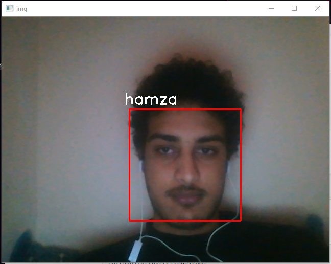

# Face Recognition

A Python script for detecting and recognizing faces in videos using the `keras_facenet` library. The script leverages MTCNN for face detection and FaceNet for generating face embeddings. For each frame, faces are detected, encoded, and compared against a database of known faces.

## Features

- Detects faces in video frames
- Extracts face landmarks and embeddings
- Compares detected faces with a custom dataset
- Easily add new identities to the database
- Utility script to capture face images

## Getting Started

### 1. Prepare Your Dataset

To test with your own face:

1. Create a folder inside the `dataset` directory named after yourself.
2. Add several clear images of your face to this folder.

You can use the provided `take_pics` script to capture images (press <kbd>Space</kbd> to take a picture).



### 2. Install Requirements

Install the required Python packages using pip:

```bash
pip install -r requirements.txt
```

### 3. Run the Script

Follow the instructions in the main script to start face recognition on your video input.


## License

This project is licensed under the MIT License.

## Acknowledgements

- [keras_facenet](https://github.com/nyoki-mtl/keras-facenet)
- [MTCNN](https://github.com/ipazc/mtcnn)
- [FaceNet](https://github.com/davidsandberg/facenet)

